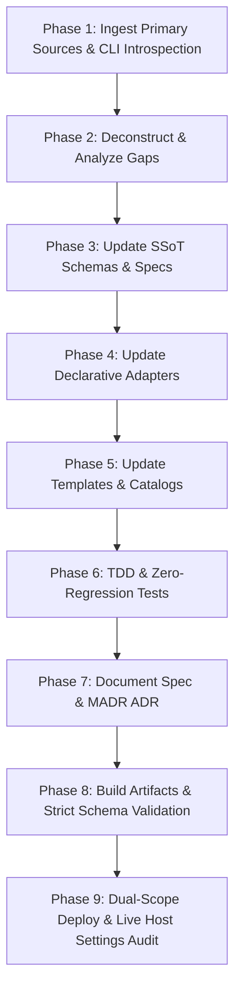

# Harness Specification Updater (XHS Multi-Harness Sync Protocol)

This skill dictates the deterministic, end-to-end procedure for detecting new coding agent updates across all supported harnesses:
- **Google Antigravity** (CLI, IDE, 2.0, SDK)
- **OpenAI Codex CLI** (`codex-rs`)
- **Anthropic Claude Code CLI**
- **Pi Coding Agent** (`earendil-works/pi`)

It ingests authoritative primary specifications, analyzes behavioral and schema gaps, and seamlessly aligns XHS SSoT schemas, declarative adapters, default catalogs, Jinja2 templates, tests, and ADRs with **Zero Regression**.

---

## 🎯 When to Activate

Trigger this skill whenever:
- User prompts include:
  - "ハーネス仕様を最新に追従して / 仕様変更を確認して"
  - "agy / codex / claude code / pi のアップデート対応して"
  - "sync harness spec" / "update harness spec" / "check agent updates"
- A local agent CLI version advances (e.g. `agy --version`, `codex --version`, `pi --version`).
- Official primary schemas change (e.g. `https://json.schemastore.org/claude-code-settings.json`, `https://developers.openai.com/codex/config-schema.json`).
- Runtime sandbox or permission errors occur (e.g. `sandbox configuration error: globs not supported`, `unknown permission action`).

---

## 🛠 Unified 9-Phase Execution Workflow



---

### Phase 1: Proactive Detection & Ingestion (能動的検知・一次情報同期)

> [!IMPORTANT]
> **Golden Rule**: No Git Log Fishing for the Unknown. Proactively detect version drift and ingest authoritative upstream schemas using `xhs spec`.

1. **Audit Versions & Upstream Drift**:
   ```bash
   # Proactively check all harnesses for updates
   uv run xhs spec check

   # Machine-readable output for autonomous loops
   uv run xhs spec check --json
   ```

2. **Sync Authoritative Primary Sources**:
   ```bash
   # Sync all agents (CLI metadata + live schemas + official docs)
   uv run xhs spec sync --agent all

   # Or target a specific agent
   uv run xhs spec sync --agent antigravity  # or codex, claude, pi
   ```

#### Primary Source Ingestion Targets:
1. **Google Antigravity (App, CLI, IDE, SDK)**:
   - **Local Built-in Docs & CLI Introspection**:
     - Built-in Customization Specs: `~/.gemini/antigravity-cli/builtin/skills/agy-customizations/docs/` (`hooks.md`, `skills.md`, `rules.md`, `plugins.md`, `mcp_servers.md`, `json_configs.md`).
     - Built-in Surface Guides: `~/.gemini/antigravity-cli/builtin/skills/antigravity_guide/references/` (`cli.md`, `ide.md`, `app.md`, `sdk.md`).
     - CLI Introspection: `agy --version`, `agy changelog` (first 50 lines), `agy models`, `agy --help` saved to `docs/reference/antigravity/local-agy-info.json`.
   - **Official Documentation Endpoints & Dynamic Crawler** (synced via `scripts/sync_antigravity_spec.py` or `xhs spec sync --agent antigravity` with automatic sidebar navigation discovery to `docs/reference/antigravity/`):
     - **Customizations & Lifecycle Hooks**:
       - Lifecycle Hooks: `https://antigravity.google/docs/hooks` (`hooks.md`)
       - Agent Skills: `https://antigravity.google/docs/skills` (`skills.md`)
       - Rules & Workflows: `https://antigravity.google/docs/rules-workflows` (`rules-workflows.md`)
       - Plugins: `https://antigravity.google/docs/plugins` (`plugins.md`)
       - Sidecars: `https://antigravity.google/docs/sidecars` (`sidecars.md`)
       - Model Context Protocol (MCP): `https://antigravity.google/docs/mcp` (`mcp.md`)
       - Custom Subagents: `https://antigravity.google/docs/subagents` (`subagents.md`)
       - Marketplace: `https://antigravity.google/docs/marketplace` (`marketplace.md`)
     - **Permissions, Sandbox & Security Boundaries**:
       - General Permissions: `https://antigravity.google/docs/permissions` (`permissions.md`)
       - CLI Permissions: `https://antigravity.google/docs/cli/permissions` (`cli-permissions.md`)
       - CLI Terminal Sandbox: `https://antigravity.google/docs/cli/sandbox` (`cli-sandbox.md`)
       - Platform Sandbox: `https://antigravity.google/docs/sandbox` (`sandbox.md`)
     - **Antigravity CLI (`agy`) & Terminal Experience**:
       - Reference & Settings: `https://antigravity.google/docs/cli/reference`, `https://antigravity.google/docs/cli/settings`
       - Features & Best Practices: `https://antigravity.google/docs/cli/features`, `https://antigravity.google/docs/cli/best-practices`
       - Execution & Headless Modes: `https://antigravity.google/docs/cli/execution-modes`, `https://antigravity.google/docs/cli/headless-mode`
       - Statusline & Terminal Title: `https://antigravity.google/docs/cli/statusline`, `https://antigravity.google/docs/cli/title`
     - **Browser Automation & Testing**:
       - Browser Overview: `https://antigravity.google/docs/ide/browser`
       - Recording, Allowlist/Denylist, Profiles: `https://antigravity.google/docs/browser/recording`, `https://antigravity.google/docs/browser/allowlist-denylist`, `https://antigravity.google/docs/browser/profiles`
     - **Artifacts, Plans & Walkthroughs**:
       - Artifacts Overview: `https://antigravity.google/docs/artifacts`
       - Implementation Plans: `https://antigravity.google/docs/artifacts/plans`
       - Walkthroughs & Screenshots: `https://antigravity.google/docs/artifacts/walkthroughs`, `https://antigravity.google/docs/artifacts/screenshots`
       - CLI Artifact Review: `https://antigravity.google/docs/artifacts/review`
     - **Conversations & Interactive Sessions**:
       - Overview & Prompting: `https://antigravity.google/docs/conversations`, `https://antigravity.google/docs/conversations/prompting`
       - Conversation Management: `https://antigravity.google/docs/conversations/managing`
     - **IDE Modalities & Workflows**:
       - IDE Overview & Tab Autocomplete: `https://antigravity.google/docs/ide/overview`, `https://antigravity.google/docs/ide/tab-completion`
       - Side Panel, Agent Overview, Task Groups: `https://antigravity.google/docs/ide/agent-side-panel`, `https://antigravity.google/docs/ide/agent-overview`, `https://antigravity.google/docs/ide/task-groups`
       - Settings, Artifact Review, Vim Mode: `https://antigravity.google/docs/ide/settings`, `https://antigravity.google/docs/ide/artifact-review`, `https://antigravity.google/docs/ide/vim-mode`
       - IDE Workflows: `https://antigravity.google/docs/ide-workflows`
     - **Slash Commands & Recurring Schedules**:
       - Slash Commands: `https://antigravity.google/docs/slash-commands` (including `/agents`, `/boost`, `/browser`, `/btw`, `/changelog`, `/codesearch`, `/context`, `/credits`, `/diff`, `/effort`, `/goal`, `/grill-me`, `/learn`, `/permissions`, `/plan`, `/resume`, `/schedule`, `/statusline`, `/teamwork-preview`, `/title`, `/usage`, `/voice`)
       - Scheduled Tasks: `https://antigravity.google/docs/schedule`
     - **Desktop Command Center (App 2.0), SDK & Support**:
       - App 2.0 Hub: `https://antigravity.google/docs` (`app-hub.md`)
       - Remote Control & Python SDK: `https://antigravity.google/docs/remote-control`, `https://antigravity.google/docs/sdk/overview`
       - Changelog & Support: `https://antigravity.google/changelog`, `https://antigravity.google/support`
   - **Command Matching Invariant**:
     - `command(prefix)` matches via **word-by-word literal token prefix matching**.
     - Trailing wildcards (` *`, ` .*`) are strictly forbidden; `*` is only valid as the global wildcard `command(*)`.
2. **OpenAI Codex CLI**:
   - Local CLI: `codex --version`, `codex --help`.
   - Schema: Official JSON Schema `https://developers.openai.com/codex/config-schema.json` saved to `docs/reference/codex/config-schema.json`.
3. **Anthropic Claude Code CLI**:
   - Local CLI: `claude --version`, `claude --help`.
   - Schema: Official SchemaStore `https://json.schemastore.org/claude-code-settings.json` saved to `docs/reference/claude-code/claude-code-settings.json`.
4. **Pi Coding Agent**:
   - Local CLI: `pi --version`, `pi --help`.
   - Docs: Official documentation from `earendil-works/pi` (`packages/coding-agent/docs/settings.md`) saved to `docs/reference/pi/settings.md`.

Check the emitted report at `docs/reference/harness-sync-report.json`.

---

### Phase 2: Deconstruct & Analyze Gaps (差分と制約の批判的解体)

Analyze detected gaps automatically using `xhs spec diff`:

```bash
# Analyze specification gaps for a harness
uv run xhs spec diff --agent antigravity
uv run xhs spec diff --agent antigravity --json
```

| Audit Dimension | Antigravity | OpenAI Codex | Claude Code | Pi Agent |
| :--- | :--- | :--- | :--- | :--- |
| **Permissions** | `allow` / `deny` / `ask` (Token prefix matching; **trailing ' *' forbidden**) | `[approvals] trusted_commands` | `allow` / `deny` / `ask`, `defaultMode` | `defaultProjectTrust` (`ask` / `always` / `never`) |
| **Sandbox Invariants** | Seatbelt (Directory paths strictly recursive; **globs forbidden**; absolute paths required) | `sandbox_mode = "workspace-write"`, `writable_roots` | `sandbox.filesystem` (`denyRead`, `denyWrite`, `allowWrite`) | Minimal core (`read`, `write`, `edit`, `bash`) |
| **Network Control** | `read_url`, `execute_url` actions | `network_access = true` | `WebFetch(domain:...)`, `sandbox.network` | via packages/extensions |
| **New Features** | `unsandboxed(...)`, `colorScheme`, `artifactReviewPolicy` | `[features] hooks`, `multi_agent_v2`, `context_management`, etc. | `autoUpdatesChannel`, `autoMemoryEnabled` | `npm:pi-subagents`, `agentOverrides` |
| **Preserved Keys** | Dynamic approvals, trusted paths | `marketplaces`, `plugins`, `desktop`, `profiles` | `enabledPlugins`, `hooks`, `mcpServers`, `theme` | `defaultThinkingLevel`, `defaultTools`, `env` |

---

### Phase 2.5: Proactive User Hearing & Proposal (新設定・新機能のユーザーヒアリングと提案)

> [!IMPORTANT]
> **User Hearing Invariant**: 新しい設定項目や挙動変更が検出された場合、AI が独断で設定値を決めてサイレントに適用してはならない。必ずユーザーに「どのように設定しますか？」とヒアリング・推奨提案を行うこと。

1. **CLI インタビューの実行**:
   ```bash
   # 新設定の候補と推奨値を表示・確認
   uv run xhs spec interview --agent antigravity
   ```
2. **インタラクティブ・ヒアリングの手順**:
   - `ask_question` ツール（または対話プロンプト）を用いて、以下の 3 点を必ず構造化してユーザーに提示する:
     1. **機能の目的と概要**: なぜその設定が追加されたのか。
     2. **推奨設定（Recommended）とその理由**: 安全性・トークン消費・開発速度の観点からのベストプラクティス。
     3. **選択肢とトレードオフ**: 代替設定を選択した場合の影響範囲。
   - ユーザーの回答・選択に基づき、SSoT カタログ（`catalog/`）または設定ポリシーを更新する。

---

### Phase 3: Automatic Gap Alignment & Absorption (仕様差異の自動吸収)

Automatically absorb detected gaps using the alignment engine:

```bash
# Preview automated alignments without modifying files
uv run xhs spec align --agent antigravity --dry-run

# Automatically apply supported alignments (spec pins, path cleansing, schema sync)
uv run xhs spec align --agent antigravity --auto-fix
```

### Phase 4: SSoT Schemas & Declarative Adapters Refinement (スキーマ・アダプタ深層整合)

For manual or non-trivial architectural gaps identified in Phase 2:

1. **Update Pydantic Core Schemas** (`src/xhs/core/schema.py`, `schema_agent_manifest.py`):
   - Extend `PermissionsPolicySchema` with any new high-level permission types.
   - Extend agent-specific schemas with newly added official keys.
2. **Update Agent Manifest Specifications** (`catalog/agents/specs/<agent>.yaml`):
   - Ensure `version` pin reflects the latest inspected release.
   - Add new dynamic/user-controlled keys to `preserved_key_paths`.
3. **Declarative Adapters** (`src/xhs/adapters/security_adapter.py`):
   - Ensure Seatbelt hygiene: Never output tilde paths (`~`) or non-absolute paths for Antigravity.
   - Rely on native system protection boundaries and workspace isolation for home directory assets.

---

### Phase 5: Update Templates & Catalogs (テンプレート・カタログ更新)

1. **Jinja2 Templates** (`catalog/templates/<agent>/`):
   - Align template syntax with official JSON/TOML schemas.
   - Example: `catalog/templates/claude-code/settings.json.j2` (`$schema`), `catalog/templates/codex/config.toml.j2` (`[features]`), `catalog/templates/pi/settings.json.j2` (`packages`).
2. **Default Security Policy** (`catalog/components/security/default.yaml`):
   - Add safe baseline grants for newly introduced action types (e.g. `allow_unsandboxed` for `git push`, `docker *`, `gh *`).

---

### Phase 6: TDD & Zero-Regression Tests (TDD・品質ゲート)

Always follow the Red-Green-Refactor discipline:

1. **Write Targeted Test First**:
   Add test cases in `tests/test_security_adapter.py` verifying the new behavior and regression safety.
   ```bash
   uv run pytest tests/test_security_adapter.py
   ```
2. **Full Test Suite & Quality Gates**:
   ```bash
   uv run pytest                                # Full 152+ test suite (0 regressions)
   uv run ruff check src/ tests/ scripts/       # Lint analysis
   uv run ruff format --check src/ tests/ scripts/ # Formatting check
   uv run xhs validate                          # SSoT catalog schema validation
   uv run xhs doctor                            # Health and syntax diagnostics
   ```

---

### Phase 7: Document Spec & MADR ADR (仕様書・意思決定記録)

1. **Update Harness Reference Specs**:
   Update or create the reference document in `catalog/components/skills/harness-spec-updater/references/`:
   - [antigravity-spec.md](./references/antigravity-spec.md)
   - [codex-spec.md](./references/codex-spec.md)
   - [claude-code-spec.md](./references/claude-code-spec.md)
   - [pi-spec.md](./references/pi-spec.md)
   - Ensure [INDEX.md](./references/INDEX.md) reflects all specifications.
2. **Record Architectural Decision Record (ADR)**:
   Create `docs/adr/00XX-<agent>-<version>-alignment.md` in MADR format:
   - **Context**: Upstream release changes, schema diffs, primary source links.
   - **Decision**: Schema additions, mapping tables, normalization logic, template updates.
   - **Consequences**: Zero regression across all peer harnesses, sandbox security invariants preserved.

---

### Phase 8: Build Artifacts & Automated Schema Conformance (ビルド成果物の厳格な公式スキーマ検証)

> [!IMPORTANT]
> **Schema Conformance Invariant**: ビルド完了時、単に「生成された」で済ませてはならない。必ず公式スキーマストアや公式 JSON Schema 定義に対して自動バリデーションを実行し、構文・構造エラーが 0 件であることを機械的に実証すること。

1. **Build All Target Profiles**:
   ```bash
   uv run xhs build --profile base
   uv run xhs build --profile xhs
   ```

2. **Automated Official JSON Schema & Seatbelt Validation**:
   `scripts/verify_harness_schemas.py` を実行し、`dist/` 成果物が公式スキーマに完全適合していることを機械的に確認（エラー 0 件必須）：
   ```bash
   uv run python scripts/verify_harness_schemas.py --target dist --profile base
   uv run python scripts/verify_harness_schemas.py --target dist --profile xhs
   ```
   - **Pi Agent**: `docs/reference/pi/settings.schema.json` に対して 0 件エラーであることを検証。
   - **Claude Code**: 公式 SchemaStore `claude-code-settings.json` に対して 0 件エラーであることを検証。
   - **OpenAI Codex**: 公式 `config-schema.json` に対して 0 件エラーであることを検証（`developer_instructions` / `notify` の配置、`max_concurrent_threads_per_session`、`mcp_servers` の `enabled: true` 制約）。
   - **Antigravity**: macOS Seatbelt を破壊する非絶対パス（`not startswith("/") and != "*"`）が 0 件であること、および `command(...)` ルールが公式トークンプレフィックス仕様（word-by-word token prefix）に適合し、末尾に不正なシェルグロブ（` *`, ` .*`）を含まないことを機械的に検証。

---

### Phase 9: Dual-Scope Deploy & Live Host Settings Audit (二重スコープデプロイと実機設定監査)

1. **Preview Diff**:
   ```bash
   uv run xhs diff --profile base --scope project --target .
   ```

2. **Dual-Scope Live Deployment**:
   プロジェクト領域（`--scope project`）のみならず、必ずホスト環境のグローバル領域（`--scope global`）へも本デプロイを実行する：
   ```bash
   # 1. Project-level deployment
   uv run xhs deploy --profile base --scope project --target . --force

   # 2. Global-level deployment to host user environment
   uv run xhs deploy --profile base --scope global --force
   ```

3. **Audit Live Host Deployed Files**:
   実際にユーザーホームディレクトリ（`~`）に配置された実機設定ファイルを直接ロード・監査し、公式スキーマ適合性および構文健全性を確認：
   ```bash
   uv run python scripts/verify_harness_schemas.py --target global
   ```

4. **Execute Full System Diagnostics**:
   ```bash
   uv run xhs doctor
   ```
   すべてのハーネスのバージョン整合性およびシンタックスが valid であることを確認。

---

## 🔒 Non-Negotiable Invariants

- **Mechanical Schema Conformance**: Never rely on intuition or subjective 'looks good'. Built artifacts and deployed host settings MUST pass `scripts/verify_harness_schemas.py` with 0 validation errors before declaring completion.
- **Dual-Scope Deployment Discipline**: Always deploy to both project (`.`) and global (`~`) scopes when aligning universal harness specifications, ensuring no host environment drift.
- **Zero Regression on Peer Harnesses**: Modifying one agent must NEVER break another. All 4 peer harnesses must pass clean in `pytest`.
- **Seatbelt Path Hygiene (Antigravity)**: Antigravity sandbox strictly forbids globs and non-absolute relative paths (e.g. `.env`) in path rules. Directory paths are inherently recursive and must be absolute.
- **Official Schema as SSoT**: Never invent flags, keys, or configurations from intuition. Validate against official JSON/TOML schemas.
- **Preserve User Local States**: Always register interactive state keys (plugins, theme, token limits) in `preserved_key_paths`.
